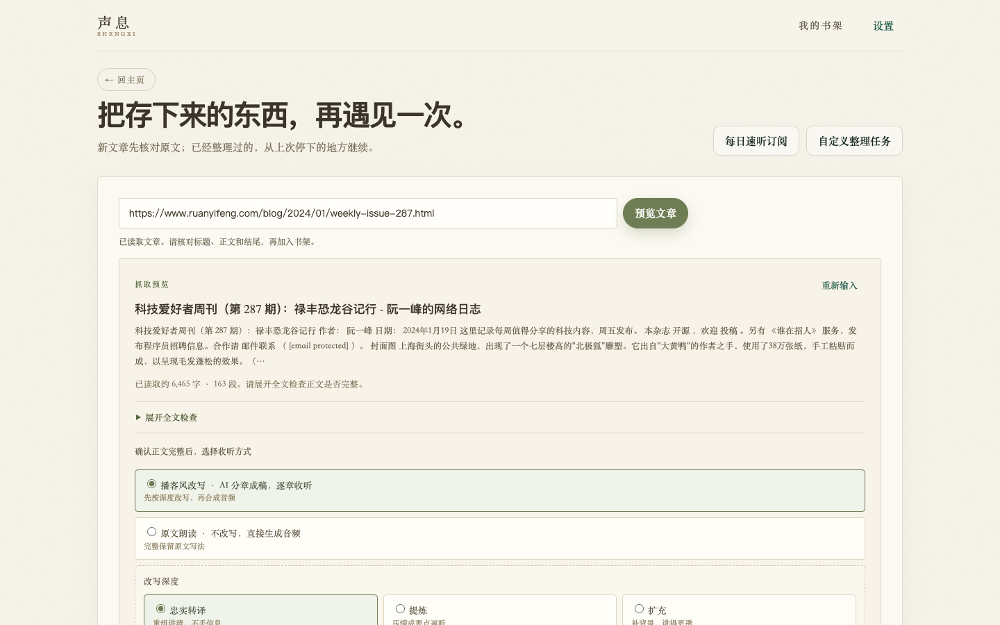
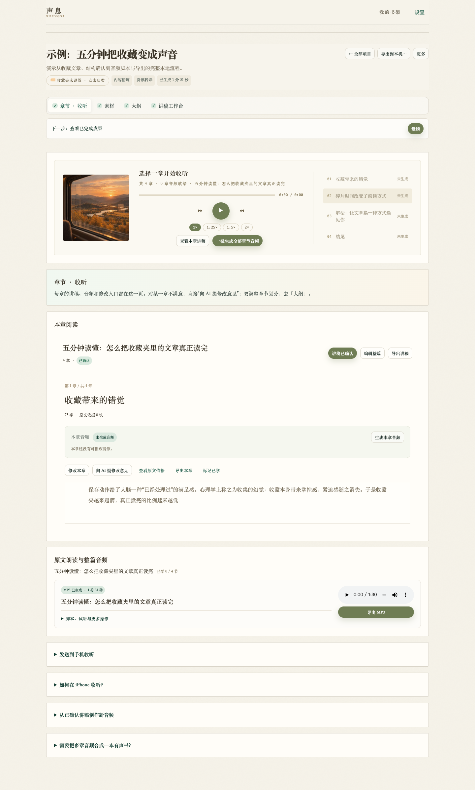
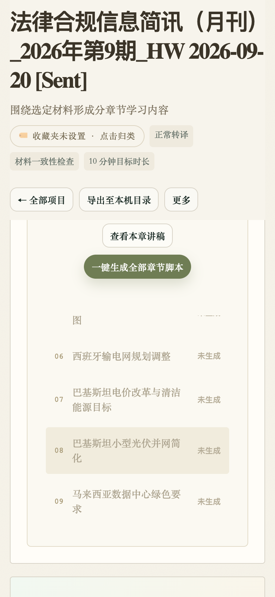
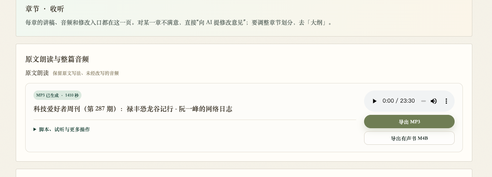

# 声息 Shengxi · 体验报告与优化建议

> 体验版本：0.1.0  
> 体验环境：macOS · Chrome，1440×900 / 1024×768 / 768×1024 / 390×844 / 320×700  
> 样本：真实书架 26 个项目 + 独立临时数据目录的全新实例（避免影响真实数据）  
> 日期：2026-10-19

---

## 结论先行

**这是一个气质非常统一、完成度超出预期的本地优先产品。** 纸感配色、宋体标题、插画、留白和克制的文案，已经让它不像一个“AI 工具”，而像一本可以带走的电子杂志。隐私边界、核验闸门、本地语音这些“难而正确”的事也做了。

真正拖后腿的不是“好不好看”，而是三件事：

1. **承诺与结果不一致**：目标 10 分钟的项目可能生成 3 小时内容；首页说“三个章节”，示例只有一条 1 分半的音轨；“一次性链接”实际 7 天有效。
2. **主线不够收敛**：项目页有两套章节阅读器、三层导航、重复的“生成音频”入口；用户需要先理解产品结构，才能开始听。
3. **移动端与分享链路有硬伤**：项目页吸顶头部占掉 37% 屏幕；在当前 11.x 企业网段下，二维码指向 `127.0.0.1`，手机扫不开；过期链接直接返回 JSON。

优化优先级建议：**先修信任问题，再收主线，最后打磨手感。** 视觉本身不需要大改。

---

## 本次已修复（2026-10-19）

| 问题 | 状态 |
| --- | --- |
| 目标时长与成稿实际长度脱节 | 已改：书架/项目头部在有音频时显示实际时长；播客风改为「时长不设上限」，不再把目标分钟数当承诺 |
| 新建任务链接失败留下空项目 | 已改：链接导入失败会回滚刚创建的项目，对话框保留；错误文案改为可执行的「文件导入 / 素材页粘贴」 |
| 移动端项目页吸顶头部 311px | 已改：390px 下长标题约 99px、768px 下约 76px；标题与 tab 一起吸顶 |
| 分享二维码在 11.x 网段指向 127.0.0.1 | 已改：非 RFC1918 网段接受默认路由网卡地址；增加 loopback 警告与「复制链接」；「一次性」改为「临时 7 天」 |
| 失效分享链接返回裸 JSON | 已改：返回带 viewport 的 HTML 错误页 |
| 整篇音频参与「已学」分母 | 已改：整篇音轨不进入进度分母，也不再显示「标记已学」按钮 |
| 直达原文朗读页仍讲章节/大纲 | 已改：tab 改为「原文 · 收听」，说明按直达模式切换 |
| 编辑整篇/本章未保存时离开项目 | 已改：切换书架、回主页、刷新前确认；确认离开后清空草稿 |
| 手机端书架入口 / 整篇进度头部 | 已改：移动端顶部恢复「我的书架」；标记已学后顶部进度实时更新 |
| 书架搜索/重命名、链接预览、批量控制、对比度/键盘 | 第一轮未改；第二轮已处理，见下 |

> 下面的问题描述保留为修复前的体验记录；已修复项以上表为准。

## 第二轮已处理（2026-10-19）

| 功能 | 结果 |
| --- | --- |
| 书架搜索 / 排序 | 新增搜索框（书名、备注、收藏夹）与「最近更新 / 名称 / 时长 / 学习进度」排序；空结果可一键清空筛选 |
| 重命名 | 卡片右上角 ✎、项目「更多」菜单、后端 `PUT /name` 连通；重命名后书架与项目页立即更新 |
| 链接预览 | 预览改为全宽；摘要/全文/正文结尾去掉 Markdown 标记（目前是纯文本清洗，不保留加粗/链接样式）；增加「重新输入」；预览打开时隐藏重复的导入说明 |
| 粘贴正文 | 首页新增「粘贴正文」对话框，可直接建项目并写入素材；失败会回滚空项目 |
| 批量生成 | 开始前确认章节数、字数、预计音频分钟数与可能的 TTS 费用；运行中可「停止」；状态显示逐章进度；结束/停止后恢复 |
| 项目页章节面 | 「章节 · 收听」里去掉重复的章节目录侧栏；播放器点选章节会驱动下方「本章阅读」；「讲稿工作台」仍保留完整章节目录/编辑面 |
| 无障碍 | 首页/书架/项目页自动对比度检查均为 0 项低于 AA；品牌副标、标签、卡片 meta 等字号上调；补 focus-visible；嵌套按钮键盘行为修正；`workspace-message`/测试结果加 `aria-live` |
| 其他 | 空项目的「材料结构」占位卡隐藏；移动端排序控件不再溢出；移动端顶部恢复「我的书架」 |
| 本机安装包 | 已重新打包并替换 `/Applications/声息.app`（0.1.0，临时签名），包含章节列表滚动修复；旧包备份在 `/tmp/声息-before-20261019.app` |
| 章节列表滚动 | 长列表不再内嵌滚动：默认显示前 5 章 + 「展开全部 N 章」，展开后随页面滚动，避免手势被困在 300px 列表里 |

> 项目页仍是“播放器 + 本章阅读”两段，但已去掉重复的章节侧栏；进一步合并成一个播放器/阅读器视图，需要更完整的 IA 决策，暂不在本轮强行改。  
> 预览采用纯文本清洗而非完整 Markdown 渲染；批量「停止」已接到逐章循环，但还没有用真实长任务做过端到端计时验证。

## 先肯定：这些不要改

- **品牌气质**：暖纸色 + 苔绿 + 宋体 + 水彩插画，克制、有记忆点，不像模板化的 AI SaaS。
- **文案的诚实感**：明确区分“待核验”和“事实核查”，写清“材料会发给哪个模型”“手机端只能访问领取页”。这种诚实是产品的护城河。
- **本地语音指引**：设置里的“下载婷婷（增强版）”提示具体、可执行，是很好的“把用户当成年人”的文案。
- **降级路径**：链接抓取失败、模型未配置、AI 分章失败都有兜底和下一步，而不是死路。
- **手机收听页**：章节、进度、倍速、文稿、离线缓存放在一个页面，完成度明显高于桌面端的项目页。

---

## P0：会直接影响信任或可用性的 5 个问题

### P0-1 目标时长与成稿实际长度脱节

**证据**：真实项目 `法律合规信息简讯（2026年第9期）` 头部写“10 分钟目标时长”，但 13 章正文合计约 **5.2 万字**。按中文 TTS 常见的 250–300 字/分钟，实际约 **3 小时**；大纲页自己也估算“至少约 4,517 字、收听约 19 分钟起”。同一屏里出现 10 分钟、19 分钟、3 小时三个数，用户无法判断哪个算数。

**为什么重要**：这是一个“通勤碎片时间”产品，时长是核心承诺。用户点开一个 10 分钟任务，期待的是地铁上听完；结果生成了一本 3 小时的有声书，会直接破坏信任。

**建议**：
- 播客风改写（尤其“忠实改写/扩充”）**不要显示“目标时长”**，改成“预计时长”，并在大纲生成后按章节字数给出估算。
- 如果保留目标时长，就把它做成**预算**：超出时明确提示“本次生成约 3 小时，远超 10 分钟目标；可切换‘提炼’或减少章节”，而不是默默超发。
- 书架卡片在音频就绪后显示**实际总时长**（如“3 小时 12 分”），而不是继续显示“目标 10 分钟”。
- 直达原文朗读页显示实际时长，例如“23 分 30 秒”；不要再出现“5 分钟目标”这类与实际无关的徽标。

**文案建议**：`目标 10 分钟` → `预计 19 分钟起（深度优先，不设上限）`；书架 `目标 10 分钟` → `约 3 小时 12 分`。

---

### P0-2 新建任务时链接导入失败，会留下一个空项目

**复现步骤**：
1. 点“自定义整理任务”；
2. 填任务名，填一个抓不到的微信链接；
3. 提交。

**结果**：项目已经被创建（书架从 3 个变 4 个），但链接导入失败；对话框保持打开，错误提示说“请打开文章复制正文，再用「粘贴文本」导入”——而这个对话框里**没有粘贴正文的入口**。用户重试就会不断产生同名空项目。当前书架里大量同名 `...[Sent]` 项目，很可能就有这个路径的贡献。

**建议**：
- 先校验链接、拿到正文，再创建项目；或创建后失败时自动删除刚创建的空项目（事务化）。
- 在同一个对话框里提供“粘贴正文”textarea，作为链接失败时的就地降级，而不是把用户引导到一个不存在的入口。
- 创建前做一次同名/同 URL 提示：“已存在同名项目，继续创建 / 打开已有项目”。
- 项目创建接口增加幂等键，避免重复提交。

---

### P0-3 移动端项目页吸顶头部 311px，且 tab 会滚走

**实测**：390×844 视口下，`.detail-header` 吸顶高度 **311px**（约 37% 屏幕）；因为标题可换行、meta 徽标和三个操作按钮都在里面。滚动到正文后，顶部仍被标题占满，tabbar 已经滚出屏幕——想换 tab 必须一路滚回顶部。

**证据**：

**建议**：
- 移动端只吸顶一条 **56–64px 的紧凑栏**：返回 + 项目名（单行省略）+ 更多；不要吸顶整个标题区。
- 把 tabbar 做成吸顶的第二行（或底部 tab），保证在正文深处也能切换“章节 / 素材 / 大纲”。
- 标题最多两行，超出省略；meta 徽标折叠到“更多信息”或详情抽屉。
- 768px 平板也有类似问题：播放器封面被放大到近乎整屏，建议在 <850px 切换为紧凑播放器（小封面/无封面 + 标题 + 进度）。

---

### P0-4 在当前 11.x 网段下，手机二维码指向 127.0.0.1

**实测**：本机 `en0` 地址是 `11.x` 网段（示例环境）；分享接口返回的 `lan_ip` 却是 `127.0.0.1`，页面上的链接是 `http://127.0.0.1:8080/m/...`，二维码也按这个地址生成。手机扫码必然打不开。

**原因**：`local_lan_ip()` 的排序把非 RFC1918 地址（11.x）判为不可用，回退到 loopback。这个策略在家庭 192.168 网络没问题，但在企业/校园/部分云网络会直接失效。

**建议**：
- 只要不是 loopback，就应接受“默认路由所在网卡”的地址；不要仅按 192.168/10/172.16 排序。
- 检测到回退到 `127.0.0.1` 时，页面明确警告：“未检测到可用的局域网地址，手机无法扫码；请手动填写电脑 IP”，并提供可编辑的 host 输入框。
- 提供“复制链接”按钮；二维码旁显示“手机需与电脑同一 Wi-Fi”。
- 把 `一次性领取链接` 改为 `临时收听链接（7 天有效）`；链接可吊销、可重新生成，但不是“一次性使用”。

---

### P0-5 编辑整篇时点“我的书架”，草稿会静默丢失

**复现**：项目 → 讲稿工作台 → 编辑整篇 → 修改文本 → 点顶部“我的书架”。没有确认，没有提示；再打开项目，编辑内容已不在。

**建议**：
- 在 `showShelf()` / `closeProject()` / `back-to-projects` 前统一检查未保存状态：`beforeunload` + 站内导航拦截。
- 提供“保存草稿 / 放弃 / 取消”三选一；至少不要静默丢弃。
- 编辑整篇可以自动存 localStorage 草稿，异常关闭后恢复。

---

## P1：主线收敛与关键体验

### P1-1 项目页有两套章节阅读器，三层导航

同一个“章节与音频”内容，在页面上出现两次：

1. 顶部 `章节 · 收听` 的播放器（封面 + 章节列表 + 一键生成）；
2. 下面 `按章收听与查看讲稿` 的左右栏（章节目录 + 正文 + 本章音频）。

再叠上：项目头、tabbar、“下一步”条、若干折叠卡片（发送到手机 / iPhone 收听 / 制作新音频 / 合成有声书）。用户看到的是 4–6 个视觉上等价的“下一步”。

**建议**：
- 把“章节 · 收听”做成**唯一主界面**：左侧章节目录、中间正文/播放器、右侧本章操作；`讲稿工作台` 作为该界面的“编辑模式”，而不是并列 tab。
- 删除重复的播放器；把“一键生成全部章节音频”收进“更多/批量操作”，避免在主阅读区出现高风险长任务。
- “下一步”条只在有明确未完成动作时出现；已完成项目改成“试听 / 导出”快捷操作，或直接隐藏。
- tab 的“当前步骤”圆点（●）和“激活 tab”的白底不要同时出现两个强状态；建议只保留一个激活态，步骤状态用文字/徽标表达。
- `3 表述核对` 的 3 是步骤编号（素材 → 大纲 → 表述核对），但和章节数、条数放在一起容易误读。可写成 `第 3 步 · 表述核对`，或用徽标显示待核对条数。

### P1-2 书架缺少搜索、重命名、排序、批量清理

当前 26 个项目、多个同名 `...[Sent]`，书架只有收藏夹筛选，没有搜索、排序、重命名、批量删除。导入时文件名直接变成标题（`q3-compliance.docx`），文档内的 H1 标题反而没被使用；后端有改名的 API，前端没有入口。

**证据**：

**建议**：
- 顶部增加搜索框（标题/备注/收藏夹）+ 排序（最近更新/最近收听/时长/状态）。
- 卡片“更多”里加“重命名”，双击标题也可编辑；导入时优先取文档 H1 / 网页标题，文件名作为 fallback。
- 增加“列表视图”（紧凑、适合几十个项目）与批量选择；支持按同名/同 URL 合并或清理。
- 卡片在音频就绪后显示实际总时长与“上次听到第几章”，并提供悬停“继续收听”。

### P1-3 首次“听一个示例”：等待约 20 秒，且只有一条音轨

在全新实例里点“听一个示例”，页面先显示一个 500px 高的空区块和“准备试听示例”按钮；点击后约 20 秒才出现播放器，并且只有 1 条 1 分 31 秒的音轨。首页 hero 的示意是“三个章节 10/12/8 分钟”，两者落差明显。示例还会在书架里创建一个真实项目。

**建议**：
- 随包内置一段 2–3 分钟的示例音频（或首次安装时后台预生成），让“听一个示例”点击即播。
- 如果必须现场合成，显示分步进度（“正在生成第 1/3 段…”）和预计等待时间，而不是一句“正在准备示例”。
- 示例不要污染书架，或明确标记“示例”并支持一键移除。
- 让首页三章的示意与示例的真实结构一致，避免“示意”和“实际”对不上。

### P1-4 链接预览：原始 Markdown、左栏空白、没有就地粘贴

**证据**：

- 预览的标题/摘要直接显示 `## 科技爱好者周刊...`、`[email protected]` 等 Markdown 语法；正文结尾也带 `## 往年回顾`、版权声明等页脚。
- 预览出现后，左侧“新的一篇”文案和上传区下方留下大面积空白；预览挤在中间 546px 的窄列里。
- 抓取失败时提示“用「粘贴文本」导入”，但首页快捷入口只有链接和上传，没有粘贴正文。

**建议**：
- 预览改成**全宽抽屉/面板**（或让预览跨 2 列），不要固定在中列；关闭时回到原布局。
- 预览正文用纯文本或渲染后的 Markdown；标题去掉 `##`，把“作者/日期”作为副信息；正文结尾展示最后 2–3 段而不是整段页脚。
- 在链接输入旁增加“粘贴正文”tab，失败时就地切换，形成真正的兜底。
- 失败提示去重：现在同一句话出现两次（“用「粘贴文本」导入”和“粘贴导入”），改成一句可执行的话 + 两个按钮。

### P1-5 手机收听页：整篇音轨计入进度、失效链接返回 JSON

- 手机页把“整篇”当作第 1 章，显示 `已学 0 / 5 章`，而桌面端是 4 章；点“整篇”的“标记已学”服务端返回 `saved:false`，页面没有任何反馈。用户永远无法达到 5/5。
- 链接失效/被吊销时，`/m/{token}` 返回 `{"detail":"链接不存在或已失效。"}` 的裸 JSON（视口宽度 980），而不是手机页里已经写好的 `.error` 样式。
- “离线缓存（电脑关机也能听）”这个说法不准确：局域网 HTTP 无法注册 Service Worker，页面一旦关闭/重开，仍需电脑在线；缓存只在当前页面生命周期内有效。

**建议**：
- 整篇音轨单独放，不进入章节进度；或“标记整篇已学”时一次性完成全部章节。
- 服务端对无效 token 返回带 viewport 的 HTML 错误页：“链接已失效，请让分享者重新生成”，并给出返回/联系提示。
- 文案改为“缓存后，本页即使电脑关机也能继续播放（请保持页面打开；重新打开需要电脑在线）”，或实现真正的离线壳。

### P1-6 批量生成：没有确认、没有取消、没有逐条进度

`generateAllChapterAudio` 会串行处理全部章节：先整理每章脚本，确认后再逐章合成 MP3。整个过程：
- 没有生成前的时长/字符数/费用预估；
- 没有“停止/取消”按钮；
- 章节列表在循环结束前不会逐条更新；
- 中途离开页面后仍在后台跑，用户没有明确控制权。

**建议**：
- 点击前显示确认：“将处理 13 章、约 5.2 万字音频，预计 12–20 分钟；云端 TTS 可能产生费用。”
- 增加“停止”按钮（至少完成当前章后停止），并让每章状态实时更新（排队/生成中/完成/失败）。
- 失败章支持“重试失败项”，而不是只能整批重来。
- 批量任务写入一个可见队列，关页后回来仍能看到进度。

### P1-7 直达原文朗读页仍在讲“章节/大纲”

原文朗读项目没有章节，但“章节 · 收听”页的介绍仍写：“每章的讲稿、音频和修改入口都在这一页。对某一章不满意，直接‘向 AI 提修改意见’；要调整章节划分，去「大纲」。” 此时页面没有章节，tab 里也没有“大纲”（只有“播客风改写（可选）”）。这段文案会让用户以为功能丢了。

**建议**：根据 `directListening` 切换文案：
> 原文朗读没有分章；整篇音频已生成，可直接试听、导出或发送到手机。想让内容更适合通勤，可切换到「播客风改写」再分章。

同样，“选择一章开始收听”“0 章音频就绪”在无章节音频时要改成明确的空状态和 CTA，而不是保留一个按不动的播放器。

---

## P2：打磨与无障碍

### P2-1 视觉与响应式

- **书架视觉权重**：26 张卡片都是大面积生活场景图，图片比标题更抢眼，且只有 6 张图轮换；要翻五屏左右才能看完。建议列表视图、封面可选/生成、或把封面缩小到 16:10 的缩略图。
- **项目页纵向堆叠**：章节页 2,400px 高、大纲编辑页 7,100px 高；大量卡片和折叠项。建议“一屏一主任务”，长表单改成步骤式或左右分栏。
- **空卡片**：没有素材时仍显示“材料结构 / 这里可以查看原文结构和辅助核对信息”。没有内容就隐藏，避免制造“这里应该有东西”的焦虑。
- **吸顶高度**：桌面端项目头 138px 也偏高；滚动阅读时建议压缩成“标题 + 当前 tab”一行。
- **对比度**：实测 `＋ 收藏夹` 2.8:1、eyebrow 3.19:1、小号 meta 3.62:1、白字主按钮 4.43:1；均低于 WCAG AA 的 4.5:1。大量 8.5–11.5px 字号（品牌副标 8.5px、标签 11px、卡片 meta 11.5px）。建议设一个最小字号 12px、正文 15px，并把 secondary 文本加深到至少 4.5:1。
- **触控目标**：卡片“＋收藏夹”按钮高 28px，低于 44px 的移动端建议值；移动端加高或改为图标按钮。
- **焦点与语义**：项目卡是 `div role=button`，内部又嵌套“＋收藏夹”按钮；键盘聚焦到收藏夹按钮按 Enter，会打开项目而不是收藏夹弹窗（实测）。建议卡片用 `<a>`/`<button>` 承载主操作，收藏夹按钮移出卡片点击区，或在 keydown 里判断 `event.target`。
- **异步提示**：`workspace-message` 没有 `role=status` / `aria-live`，屏幕阅读器听不到生成成功/失败。`provider-test-result` 同样。建议统一加 `role=status`、`aria-live="polite"`。
- **表单标签**：素材标题、来源链接、粘贴正文只有 placeholder，没有 `<label>`；设置里的部分字段也是 placeholder 承担标签。建议补 visually-hidden label。

### P2-2 文案与术语

产品文案整体很好，但“同义词太多”会让新用户误以为是不同功能。建议建立一份术语表：

| 现在混用 | 建议统一 | 说明 |
| --- | --- | --- |
| 项目 / 任务 / 内容任务 / 整理任务 | **项目**（或“收听项目”） | 书架里的单位 |
| 素材 / 材料 / 文档 / 文章 | **素材**（导入的单位）；**原文**（内容） | “材料”用于泛指，不用于按钮 |
| 讲稿 / 脚本 | **讲稿**；**音频脚本**仅在音频上下文 | “脚本”太工程化 |
| 大纲 / 结构 / 分章 | **分章**（步骤）；**大纲**（结果） | 避免“调整章节划分”和“大纲”混用 |
| 转译 / 改写 | **改写**：忠实改写 / 提炼 / 扩充 | “正常转译”“资讯转译”不直观 |
| 核验 / 核对 / 审阅 / 审核 | **核对原文**、**核验表述**、**审阅讲稿** | 三个不同动作，不要互相替换 |
| 抓取 / 读取 / 预览 | **读取链接**（动作）、**预览**（结果） | 统一一个动词 |

**具体替换清单**：

| 位置 | 现在 | 建议 |
| --- | --- | --- |
| 分享面板 | 一次性领取链接 | 临时收听链接（7 天有效） |
| 音频卡 | `MP3 已生成 · 1410 秒` | `MP3 已生成 · 23 分 30 秒` |
| 大纲估算 | `预计至少约 50 字、收听约 1 分钟起` | 低于阈值时隐藏；否则显示“约 X 分钟”并说明依据 |
| 语音卡 | `已学 0 / 5 章`（含整篇） | `已学 0 / 4 章` + 单独“整篇音频” |
| 分享空状态 | `回到电脑端「音频与导出」先生成` | `回到电脑端，在项目的「章节 · 收听」里生成音频后再分享` |
| 直达音频介绍 | `对某一章不满意…去「大纲」` | 按直达模式改写，见 P1-7 |
| 更多菜单 | `刷新任务` | `重新载入项目` |
| 更多菜单 | `删除任务` | `删除项目` |
| 空项目按钮 | `导出至本机目录`（可点但报错） | `导出到本机…`，无内容时禁用并提示 |
| 设置更新 | `暂未获取到公开发布版本，请稍后重试` | `暂时无法检查更新（更新服务未连接）` |
| 手机缓存 | `电脑关机也能听` | `缓存后本页可离线播放（请保持页面打开）` |

> 现有文案里最有价值的是那些“有分寸的句子”，例如“待核验提示不等于事实核查已经完成”“密钥仅保存在本机”。优化时保留这种语气，不要改成“立即体验”“一键搞定”。

### P2-3 工程与细节

- **favicon 404**：页面没有 `<link rel="icon">`，每次加载都请求 `/favicon.ico` 并 404；已有 `icon-180.png`，顺手补 favicon 与 apple-touch-icon。
- **更新检查**：GitHub API 返回 404 时，UI 仍显示“请稍后重试”，用户不知道是没网、没发布还是仓库迁移。建议区分“未连接/无新版本/开发版”三种状态。
- **路由与刷新**：项目页没有 URL 状态；刷新回到首页 hero，浏览器后退直接离开应用。建议用 hash 路由（`#/project/{id}/{tab}`）并恢复上次视图；至少刷新后回到书架。
- **原生音频控件**：直达音频卡使用浏览器原生播放器，和整套自定义播放器视觉不一致；建议复用同一套播放器组件，或至少统一圆角/字号。
- **数字格式**：秒数、时长、字数统一用 `1 分 35 秒 / 23 分 30 秒`，不要混用 `95 秒`、`1:35`、`1410 秒`。

- **拖拽上传**：项目页和书架都支持拖拽，但视觉上没有 dragover 的强反馈；建议拖入时高亮边框 + “松手导入”。
- **AI 成本预期**：确认章节后会串行生成全部章节讲稿，但确认按钮没有说明“将调用 N 次模型、预计几分钟”。建议在按钮旁显示调用次数/预计时长，或提供“先生成第 1 章试听”。

---

## 建议的落地顺序

### 这一周（P0，信任修复）

1. 目标时长：从播客/直达模式移除“目标 10 分钟”或改成“预计”；书架显示实际时长。
2. 链接导入失败：事务化创建/删除，对话框内加“粘贴正文”。
3. 移动端项目页：紧凑吸顶栏 + tab 吸顶。
4. 分享：修正 LAN IP 回退（11.x/非 RFC1918），加 loopback 警告、复制链接、可编辑 host。
5. 编辑草稿：导航拦截 + localStorage 草稿。
6. 分享失效：返回 HTML 错误页；手机页整篇音轨移出进度。

### 两周内（P1，主线收敛）

7. 项目页合并“章节 · 收听”和“讲稿工作台”，删除重复播放器，压缩纵向卡片。
8. 书架：搜索、排序、重命名、批量选择、同名/同 URL 提示。
9. 首次示例：内置音频或分步进度；示例不污染书架。
10. 链接预览：全宽、去 Markdown、正文结尾可读、粘贴兜底。
11. 批量生成：确认、预估、取消、逐章状态、失败重试。
12. 直达音频页文案随模式切换。

### 下一版（P2，手感与无障碍）

13. 术语表 + 全站文案替换。
14. 对比度/字号/触控目标/aria-live/键盘卡片。
15. favicon、更新状态、hash 路由、数字格式、原生播放器统一。
16. 播放器键盘快捷键、媒体键（桌面）、睡眠定时器；书架“继续收听”。

---

## 附：体验路径

- 首页 → 听一个示例（全新数据实例，观察生成等待与音轨数量）
- 书架（26 个项目）→ 收藏夹筛选 → 项目详情（章节 / 素材 / 大纲 / 表述核对 / 讲稿工作台）
- 新建任务（空表单、校验、带链接失败）
- 链接预览（公开文章、失败链接）→ 创建项目
- 上传 DOCX / 粘贴正文 → 材料结构
- 原文朗读（生成整篇音频）→ 试听页 → 发送到手机
- 讲稿工作台（编辑整篇、修改意见、调整章节）
- 手机收听页（正常、播放、失效链接、整篇进度）
- 设置（模型、TTS、本地音色、更新）
- 响应式：1440 / 1024 / 768 / 390 / 320

> 说明：为避免产生费用，本次没有主动调用文本模型生成新内容；AI 相关结论来自已有项目结果、无模型降级路径和代码行为。TTS 使用本地/免费链路做了真实音频验证。测试产生的分享链接已吊销，临时实例已停止。
